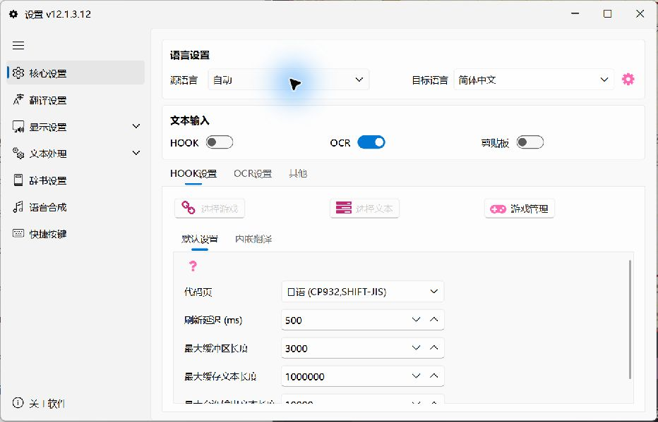
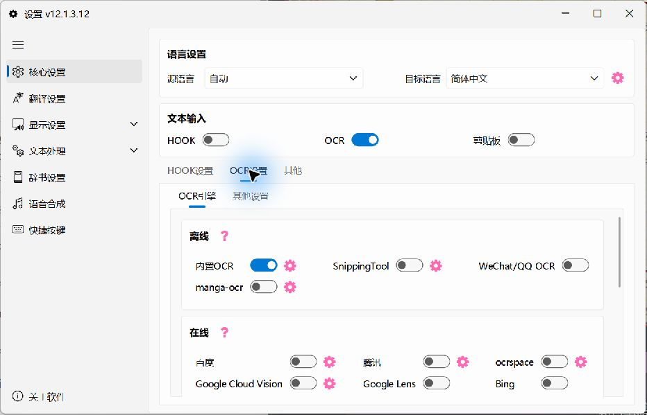
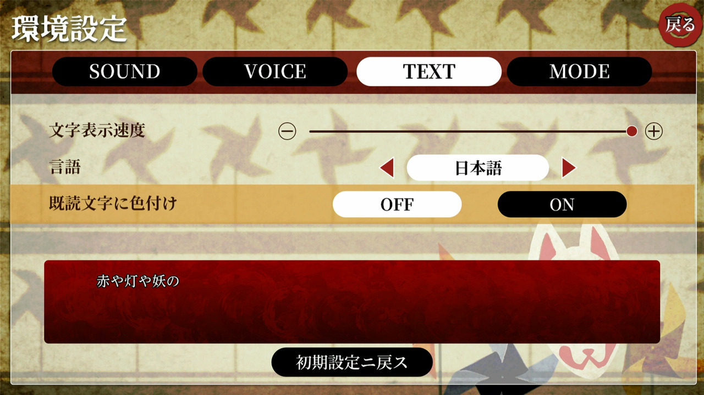
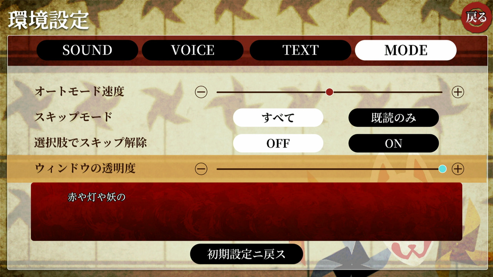
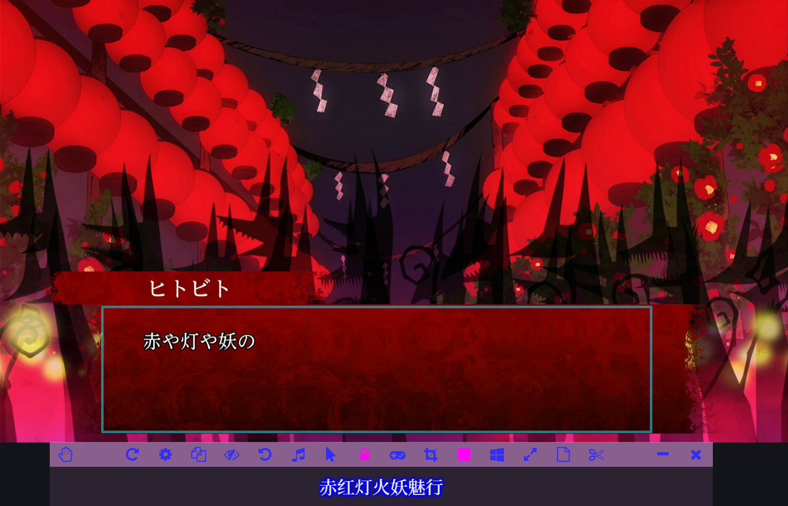
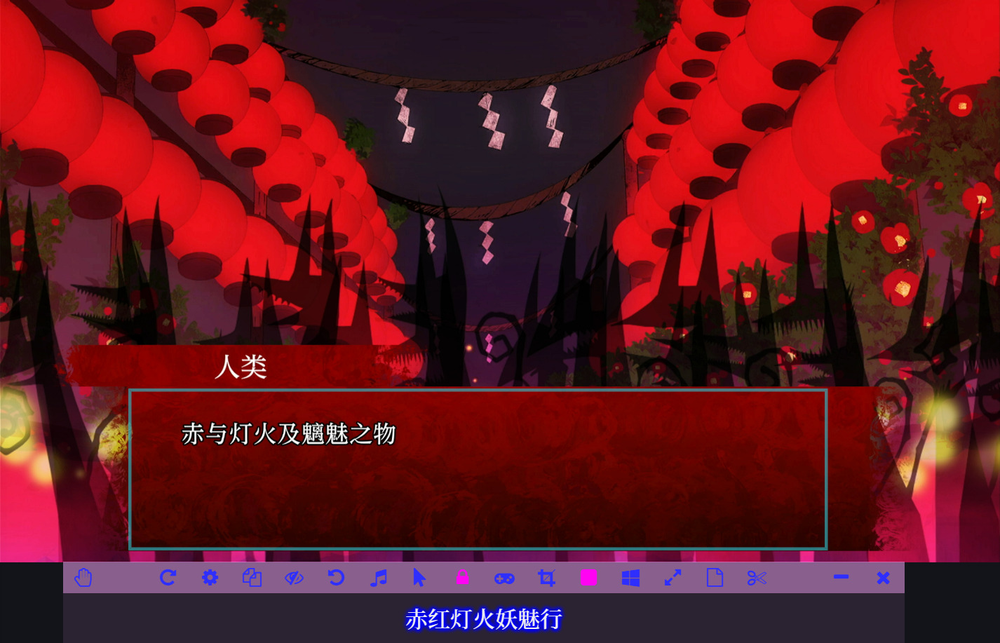
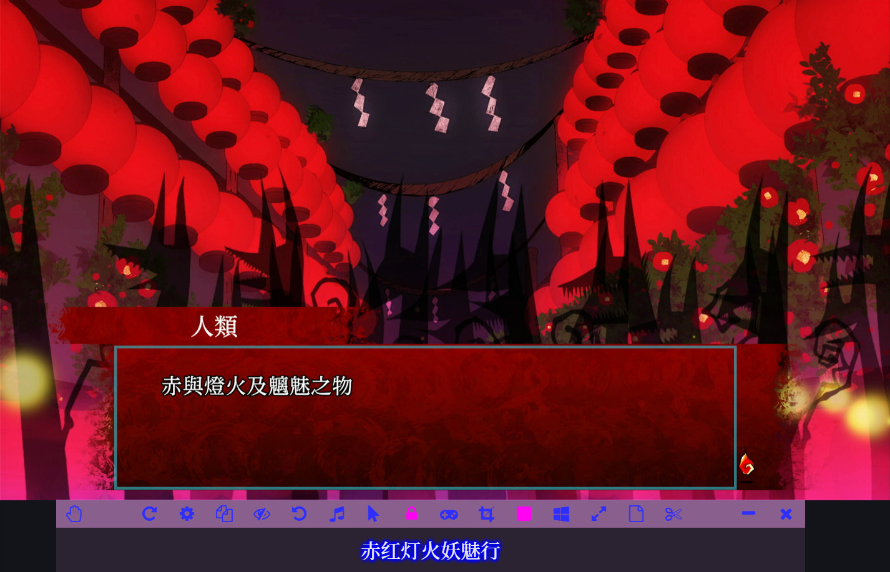

# Luna OCR · 赤灯 NS 投屏翻译使用说明

**适用于 NS 实机：通过采集卡投屏到电脑，让 Luna OCR 识别游戏文字，再显示汉化组修订好的译文。**

玩 Steam 版请使用仓库首页的 **[Steam 汉化补丁](../README.md)**。

游戏里可以选择日文、官方简体中文或官方繁体中文；电脑上可以显示民间汉化的简体或繁体译文。适合 NS 实机通过采集卡在电脑上玩的情况。

首次安装一次，以后双击桌面图标就能用。下载和使用都无需登录 GitHub，也不需要验证码、付费翻译接口或单独安装 Python。

Luna 的基础操作和 OCR 详细设置可参考：[Flamecho《LunaTranslator 预翻译文件使用教程》](https://www.flamecho.top/p/pretrans-guide)（侵删）。NS 采集卡投屏请看其中的 **OCR 模式**部分。

**赤灯这套自动更新版的安装按下文操作，翻译源保留「自定义翻译」即可；无需按外部教程另选 sqlite／JSON 文件或调整它们的匹配百分比。**

## 使用前：先把 NS 画面接到电脑

连接顺序：**NS 底座 → HDMI 线 → 采集卡 → USB 线 → 电脑**。

用 OBS 的「视频采集设备」显示采集卡画面，再用 Luna 识别画面中的台词。需要放大时可使用 OBS 的「窗口化投影」。**不需要开始直播或录制。** 已经能用其他采集卡软件投屏，也可以继续使用。

## 1．准备 Luna

从 [LunaTranslator 下载页](https://github.com/HIllya51/LunaTranslator/releases) 下载适合电脑的版本，解压后确认能找到 **LunaTranslator.exe**。已经安装的直接继续下一步。

## 2．安装赤灯预翻译

1. 打开 **[NS Luna OCR 下载页](https://github.com/Haccayukie/Akaaka_Steam_Patch/releases/tag/luna-ocr-v1)**。
2. 在页面下方 **Assets（资源）**中下载 **Akaaka_NS_Luna_OCR_Install.cmd**。**不用解压，也不用下载 Source code。**
3. 完全退出正在运行的 Luna，双击下载好的 **Akaaka_NS_Luna_OCR_Install.cmd**。
4. 出现选择文件的窗口后，找到 Luna 文件夹，选中 **LunaTranslator.exe**，点击“打开”。
5. 等下载和安装结束。电脑桌面会出现 **“赤灯预翻译”** 图标，Luna 也会自动打开。

安装完成后会打开 Luna。以后可以任选下面一种方式启动，不必依赖桌面图标：

- **继续双击下载的 Akaaka_NS_Luna_OCR_Install.cmd**：第一次负责安装，以后直接启动。
- **双击 Luna 文件夹里的 Start_Akaaka_Luna_OCR.cmd**。
- **双击桌面的“赤灯预翻译”快捷方式**（如果已创建）。

如果找不到桌面图标，使用前两种方式即可。**CMD 是安装／启动文件，不是预翻译词库，不需要在 Luna 里把它选为翻译文件。**

## 3．第一次使用，按这四步设置

### ① 选好要显示的语言

点击 Luna 工具栏上的**齿轮**打开设置，找到“源语言”和“目标语言”。

| 设置 | 怎么选 |
|---|---|
| 源语言 | **自动**，保持这个选项即可 |
| 目标语言 | 想看简体就选**简体中文**，想看繁体就选**繁体中文** |

游戏里仍然可以按喜好选择日文、官方简中或官方繁中，Luna 会尝试匹配同一段内容。以后想换译文简繁，只改“目标语言”即可。

即使游戏里已经是中文，「源语言」也保持「自动」，才能正常显示汉化组译文。

### ② 打开 OCR

**OCR 就是“从画面中读出文字”。**

在设置的“文本输入”中选择 **OCR**。在“OCR设置”里启用 **内置OCR**，模型先用默认的 **PP-OCRv5_mobile**。这个模型较快，适合实时投屏。

安装入口已经开启“自定义翻译”。它会读取汉化组的译文。正常使用时保留这个翻译开关即可。

### ③ 先调整游戏里的文字显示

打开**游戏自身的「环境设定」**（不是 Luna 设置）：

- **TEXT 页面**：把「既読文字に色付け」（已读文字变色）设为 **OFF**，让台词保持白色。
- **MODE 页面**：把「ウィンドウの透明度」（对话框透明度）调到**最低透明度，也就是背景最不透的状态**。以预览中的对话框是否遮住后面的背景为准。

白字配不透明的对话框，能减少动态背景对 OCR 的干扰。

**游戏设置示例 1：TEXT → 已读文字变色选 OFF，保持白字。**

**游戏设置示例 2：MODE → 调整对话框透明度，让预览中的红色对话框遮住背景。**

### ④ 框住游戏里的文字

1. 打开采集卡投屏窗口，让游戏停在一段已经显示完整的台词上。
2. 在 Luna 的 OCR 功能中使用**选择识别范围**。
3. 按住鼠标左键拖出一个框，把**对话框中的正文**框进去。四周稍留空白。
   **识别框不要带上对话框右下角的狐火图标。** 右边界停在狐火左侧，同时给后续两三行台词留下足够空间；角色名也不必框入。
4. 松开鼠标，等待识别和匹配。成功后，Luna 窗口里会出现对应译文。

框选范围要能容纳后面出现的两三行台词。游戏窗口移动或改变大小后，请重新框选。进入地图或选项时，也要把识别范围改到地图文字或选项所在的位置。

**确认成功的方法**：看 Luna 的原文栏是否读出了游戏里的字，再看下方是否出现汉化组译文。

### 三种游戏语言的识别示例

下面三张分别是**日文、官方简中、官方繁中**的游戏画面，下方蓝字是汉化组译文。示例中的目标语言均选「简体中文」；想显示繁体译文，在 Luna 中把目标语言改成「繁体中文」即可。

**青绿色矩形就是 OCR 识别范围：只框正文，角色名留在框外；右边界停在右下角狐火图标的左侧。** 狐火会动，不要把它一起框进去。第三张可以清楚看到狐火留在识别框外。

**日文原文 → 汉化组译文**

**官方简中 → 汉化组译文**

**官方繁中 → 汉化组译文**

## 4．想让译文直接盖在游戏文字上

在 **OCR 识别框上右键**，开启 **“原地显示翻译”**。

可在右键菜单的“样式”里调整颜色和对齐；也可以继续使用下方独立字幕窗口。其他显示设置见开头的通用教程。

## 5．以后每次怎么玩

1. 打开游戏和采集卡投屏。
2. 双击下载的 **Akaaka_NS_Luna_OCR_Install.cmd**，或选择上面其他一种启动方式。
3. 确认 OCR 框仍然对准正文，开始游戏。

打开后会在后台检查更新。汉化文本、已确认的 OCR 纠错和匹配规则都会随版本更新。**平时只要正常打开使用即可。**

GitHub 暂时连不上时，会继续使用已经下载好的版本。首次安装需要联网。

## 遇到问题，先看这里

| 看到的情况 | 先做什么 |
|---|---|
| 安装时找不到要选哪个文件 | 打开解压后的 Luna 文件夹，选择 **LunaTranslator.exe** |
| 安装下载报错 | 确认电脑能打开 GitHub，再运行一次 **install.cmd** |
| Luna 的原文栏都没有字 | 检查是否启用了 OCR、内置OCR和自动运行，再重新框选正文 |
| 原文读成了别的字 | 放大投屏画面，等台词显示完整，再调整识别框。记录错误画面以便反馈 |
| 原文识别对了，却没有译文或译文不对 | 保留游戏画面与 Luna 原文、译文一起出现的截图，反馈具体句子 |
| 出现两套或多套译文 | 检查翻译开关，保留“自定义翻译” |
| 官方简中无法替换为民间简中 | 把“源语言”改成“自动”，目标仍选“简体中文” |
| 显示的还是原来的设置或词库 | 关闭 Luna，双击下载的 CMD 或 Luna 文件夹里的 Start_Akaaka_Luna_OCR.cmd |
| 没找到桌面入口 | 直接用下载的 CMD，或 Luna 文件夹里的 Start_Akaaka_Luna_OCR.cmd |

提交反馈可以使用 [反馈表单](https://tally.so/r/q55Y8d)。截图尽量同时包含游戏原句和 Luna 识别出的文字，这样更容易查清是识别错误还是匹配错误。

## 当前版本说明

这是初始试用版，支持对白、选项，以及已核对的祭典、神社、市街地图文字。短语气词、漏行或误识别仍可能影响结果；遇到问题请保留截图反馈。

想使用原来的 Luna 设置，关闭后从原来的 **LunaTranslator.exe** 打开即可。
